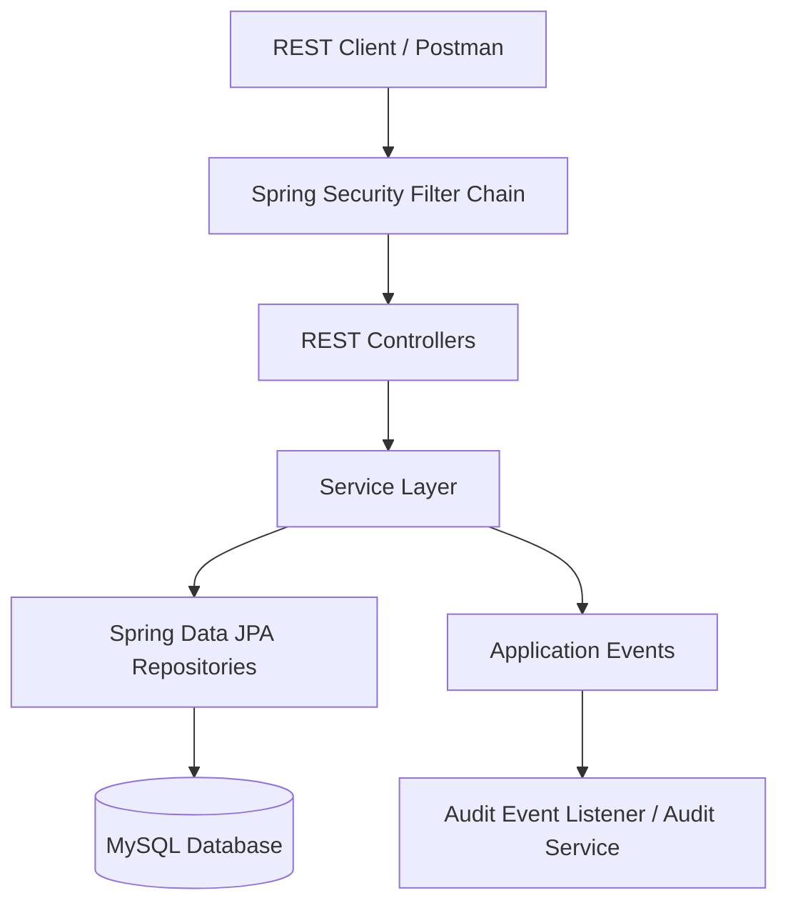
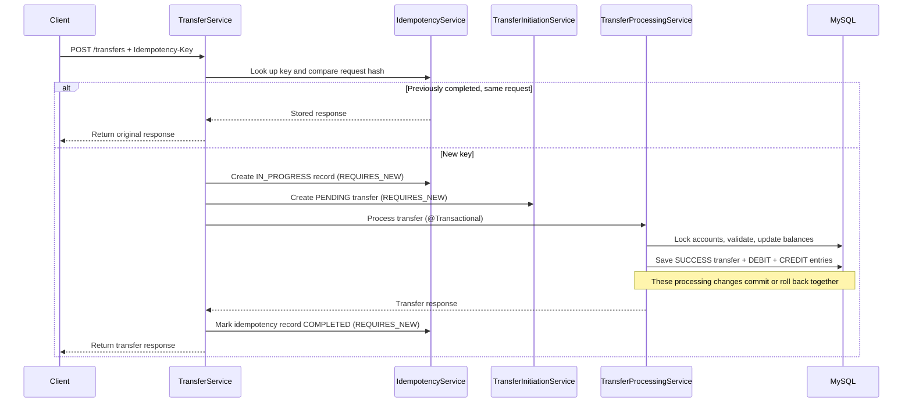

# Financial Transaction System

A Java Spring Boot REST API for managing users and bank accounts, processing account-to-account transfers, maintaining a double-entry ledger, and checking account and transfer consistency through reconciliation.

> **Project status:** This is an interview-focused, production-like backend demonstration. It showcases transaction management, database locking, idempotent request handling, JWT-based security, ledger entries, audit logging, and reconciliation. It has not been independently audited or certified for real banking or production use.

## Table of Contents

- [Overview](#overview)
- [Implemented Features](#implemented-features)
- [Technology Stack](#technology-stack)
- [Architecture](#architecture)
- [Transfer Processing Flow](#transfer-processing-flow)
- [Ledger Model](#ledger-model)
- [Concurrency Control](#concurrency-control)
- [Idempotency](#idempotency)
- [Security](#security)
- [Reconciliation](#reconciliation)
- [Project Structure](#project-structure)
- [Swagger UI and OpenAPI](#swagger-ui-and-openapi)
- [API Reference](#api-reference)
- [Run Locally](#run-locally)
- [Running Tests](#running-tests)
- [Configuration and Security Notes](#configuration-and-security-notes)
- [Known Scope and Limitations](#known-scope-and-limitations)


## Live Demo

The application is deployed on Render and can be accessed through the following links:

| Resource     | Link                                                                    |
| ------------ | ----------------------------------------------------------------------- |
| Backend API  | https://financial-transaction-system.onrender.com                       |
| Swagger UI   | https://financial-transaction-system.onrender.com/swagger-ui/index.html |
| Health Check | https://financial-transaction-system.onrender.com/actuator/health       |

Note: The application runs on Render's free tier. Initial requests may take some time if the instance is inactive.
Use Swagger UI to explore the available REST APIs and test endpoints .


## Overview

The application exposes REST endpoints for user registration and login, account creation and deposits, balance and transaction-history queries, account transfers, administrative user-status changes, and reconciliation.

For a successful transfer, the application updates both account balances and writes a matching debit and credit ledger entry in one database transaction. It also uses an idempotency key to recognize retries of the same transfer request.

## Implemented Features

- User registration and login.
- Password hashing through Spring Security's `PasswordEncoder` configuration.
- Account creation with generated account numbers.
- Account deposits with a corresponding credit ledger entry.
- Account balance and account transaction-history endpoints.
- Transfer validation for ownership, account status, currency, same-account transfers, and sufficient funds.
- Atomic transfer processing using Spring's `@Transactional` support.
- Double-entry ledger records: one debit and one credit for each successful transfer.
- Pessimistic account-row locking with a consistent account-ID lock order.
- Idempotent transfer requests using the `Idempotency-Key` header and a SHA-256 request hash.
- Audit logging, including a transfer-completion event listener.
- JWT authentication and role/ownership authorization.
- Bucket4j-based in-memory rate limiting.
- Paginated and filterable account transaction history.
- Transfer and account-balance reconciliation.
- Spring Boot Actuator health, info, and metrics endpoint exposure as configured.
- Unit and integration tests covering transfers, rollback, concurrency, ledger consistency, idempotency concurrency, and reconciliation.

## Technology Stack

| Area | Technology |
|---|---|
| Language | Java 21 |
| Framework | Spring Boot 4.1.1 |
| Web | Spring MVC (`spring-boot-starter-webmvc`) |
| Persistence | Spring Data JPA / Hibernate |
| Database | MySQL |
| Security | Spring Security, JWT (JJWT 0.12.6), BCrypt password encoder |
| Validation | Jakarta Bean Validation |
| Rate limiting | Bucket4j 8.10.1 |
| Monitoring | Spring Boot Actuator / Micrometer |
| API documentation | Springdoc OpenAPI 3.2.0, Swagger UI |
| Build | Maven Wrapper / Maven |
| Tests | Spring Boot Test, JUnit |

## Architecture

The application follows a layered Spring application structure:



The main business areas are users, accounts, transfers, ledger entries, idempotency records, audit logs, and reconciliation records. DTOs are used at API boundaries rather than exposing persistence entities directly in normal request and response flows.

## Transfer Processing Flow

A transfer request is submitted to `POST /transfers` with an `Idempotency-Key` header. The orchestration is split across the transfer and idempotency services:



The processing transaction validates the request and accounts, debits the source account, credits the destination account, updates the transfer status, and inserts both ledger entries. If processing fails, the processing transaction rolls back; the separate failure-handling service records the failed outcome.

## Ledger Model

The ledger stores account-level entries:

- `CREDIT` increases the account's ledger balance.
- `DEBIT` decreases the account's ledger balance.
- A successful transfer creates exactly two entries for the same transfer: one debit on the source account and one credit on the destination account.
- A deposit creates a credit ledger entry without a transfer reference.

The repository's account ledger-balance calculation is:

```text
Ledger balance = SUM(CREDIT amounts) - SUM(DEBIT amounts)
```

The ledger entries are used by the reconciliation service to compare the calculated ledger balance with the account's stored balance.

## Concurrency Control

The transfer-processing service retrieves both account rows using the repository's pessimistic write-lock query. It always locks the lower account ID first and then the higher account ID, regardless of transfer direction.

This consistent lock order is intended to reduce deadlocks when concurrent transfers touch the same pair of accounts in opposite directions. The transfer processing method is transactional, so balance updates and ledger writes participate in the same transaction.

## Idempotency

The transfer endpoint requires an `Idempotency-Key` request header.

The application stores an idempotency record and a SHA-256 hash of the request payload:

- Same key + same request payload: returns the previously stored response when the request has already completed.
- Same key + different request payload: rejects the request rather than treating it as a retry.
- New key: creates an in-progress record and initiates transfer processing.

The controller also validates the key length (maximum 100 characters).

## Security

- Login is provided by `POST /auth/login` and returns a JWT.
- Passwords are encoded using Spring Security's configured password encoder.
- The security configuration is stateless and uses a JWT authentication filter.
- `/auth/**`, `POST /users`, `/error`, and `/actuator/**` are configured as permitted routes.
- `/admin/**` requires the `ADMIN` role.
- User profile access is restricted to the account owner or an administrator.
- Account and transfer services perform additional ownership checks for protected operations.
- A Bucket4j filter applies an in-memory request limit keyed by client IP.

Send the token on protected requests using:

```http
Authorization: Bearer <JWT>
```

## Reconciliation

`GET /admin/reconciliation/transfers` runs reconciliation for transfers and accounts.

For successful transfers, the service checks that the ledger contains exactly two entries: one debit and one credit, with the expected amount and account references. It also checks that failed or non-successful transfers do not have ledger entries and detects ledger entries that reference unknown transfers.

For each account, it compares the stored account balance with the ledger-derived balance (`credits - debits`). The endpoint reports discrepancies; it does not automatically repair balances or ledger history.

## Project Structure

```text
src/
├── main/
│   ├── java/com/financialtransaction/
│   │   ├── account/          # Account APIs, entities, repositories and services
│   │   ├── audit/            # Audit entities, service and transfer event listener
│   │   ├── auth/             # Login API and authentication service
│   │   ├── config/           # Spring Security configuration
│   │   ├── exception/        # Global API exception handling
│   │   ├── idempotency/      # Idempotency records, hashing and service
│   │   ├── ledger/           # Ledger entity, repository, DTO and specifications
│   │   ├── reconciliation/   # Reconciliation API, entities, DTOs and service
│   │   ├── security/         # JWT, authentication filter and rate-limit filter
│   │   ├── transfer/         # Transfer API, entities, repositories and services
│   │   └── user/             # User APIs, entities, repositories and services
│   └── resources/            # Application and Spring profile properties
└── test/java/com/financialtransaction/
    # Transfer, rollback, concurrency, ledger and reconciliation tests
```

## Swagger UI and OpenAPI

The project uses Springdoc OpenAPI to generate an OpenAPI specification and provide Swagger UI for interactive API documentation.

When the application is running locally, open:

- **Swagger UI:** `http://localhost:8080/swagger-ui/index.html`
- **OpenAPI specification (JSON):** `http://localhost:8080/v3/api-docs`

Swagger UI allows you to browse documented endpoints, inspect request and response schemas, and send requests to the running application.

### Authorizing protected endpoints in Swagger UI

1. Register a user using `POST /users` and log in using `POST /auth/login`.
2. Copy the JWT returned by the login endpoint.
3. Select **Authorize** in Swagger UI and provide the JWT for the `bearerAuth` Bearer authentication scheme. If the dialog asks for the token value, paste the raw JWT; Swagger UI adds the `Bearer` prefix to the request header.
4. Execute protected endpoints. The request will include `Authorization: Bearer <JWT>`.

The OpenAPI security annotations describe authentication requirements in the documentation. They do not enforce access control. Spring Security continues to enforce authentication, ADMIN-role checks, and account ownership at runtime. The Swagger UI and OpenAPI JSON documentation routes are permitted routes; this does not make the protected business endpoints public.

## API Reference

Base URL for local development: `http://localhost:8080`.

Protected endpoints require `Authorization: Bearer <JWT>`, unless noted otherwise.

| Method | Endpoint | Purpose | Access |
|---|---|---|---|
| `POST` | `/users` | Register a user | Public |
| `GET` | `/users/{id}` | Get a user profile | Owner or ADMIN |
| `POST` | `/auth/login` | Authenticate and obtain JWT | Public |
| `POST` | `/accounts` | Create an account | Authenticated |
| `GET` | `/accounts/{id}` | Get account details | Authenticated; ownership is enforced by service logic where applicable |
| `GET` | `/accounts/{id}/balance` | Get account balance | Authenticated; account ownership enforced |
| `POST` | `/accounts/{accountId}/deposit` | Deposit into an account | Authenticated; account ownership enforced by service logic |
| `GET` | `/accounts/{id}/transactions` | Get paginated/filtered ledger history | Authenticated; account ownership enforced |
| `POST` | `/transfers` | Initiate a transfer | Authenticated; requires `Idempotency-Key` |
| `GET` | `/transfers/{transactionId}` | Get a transfer | Authenticated; participant or ADMIN check in service |
| `PATCH` | `/admin/users/{id}/status` | Change user status | ADMIN |
| `GET` | `/admin/reconciliation/transfers` | Run transfer and account reconciliation | ADMIN |

### Example: Create a user

```http
POST /users
Content-Type: application/json
```

```json
{
  "name": "Example User",
  "email": "user@example.com",
  "password": "change-me-123"
}
```

### Example: Login

```http
POST /auth/login
Content-Type: application/json
```

```json
{
  "email": "user@example.com",
  "password": "change-me-123"
}
```

The response contains a JWT. Use it as a Bearer token for protected endpoints.

### Example: Create an account

```http
POST /accounts
Authorization: Bearer <JWT>
Content-Type: application/json
```

```json
{
  "accountType": "SAVINGS"
}
```

### Example: Deposit

```http
POST /accounts/{accountId}/deposit
Authorization: Bearer <JWT>
Content-Type: application/json
```

```json
{
  "amount": 500.00
}
```

### Example: Transfer

```http
POST /transfers
Authorization: Bearer <JWT>
Idempotency-Key: unique-client-request-key
Content-Type: application/json
```

```json
{
  "fromAccountId": 101,
  "toAccountId": 102,
  "amount": 200.00
}
```

### Transaction history query parameters

`GET /accounts/{id}/transactions` supports:

| Parameter | Default | Description |
|---|---|---|
| `page` | `0` | Zero-based page number |
| `size` | `10` | Page size |
| `sortBy` | `createdAt` | Entity property to sort by |
| `direction` | `desc` | `asc` or `desc` |
| `entryType` | Not set | Optional `CREDIT` or `DEBIT` filter |
| `startDate` | Not set | Optional ISO date-time lower bound |
| `endDate` | Not set | Optional ISO date-time upper bound |

## Run Locally

### Prerequisites

- JDK 21.
- MySQL server.
- Git.

### 1. Clone the repository

```bash
git clone https://github.com/Omkarpisal2004/financial-transaction-system.git
cd financial-transaction-system
```

### 2. Create the development database

```sql
CREATE DATABASE financial_transaction_db;
```

### 3. Configure environment variables

The application expects database and JWT secrets through environment variables. Do not commit actual credentials or secrets to GitHub.

**Windows PowerShell:**

```powershell
$env:DB_PASSWORD="your_mysql_password"
$env:JWT_SECRET="your_secure_jwt_secret"
```

**Linux/macOS:**

```bash
export DB_PASSWORD="your_mysql_password"
export JWT_SECRET="your_secure_jwt_secret"
```

Keep the terminal session open when starting the application so the environment variables remain available.

### 4. Run the application

The default active Spring profile is `dev`, as configured in `application.properties`.

**Windows:**

```powershell
.\mvnw.cmd spring-boot:run
```

**Linux/macOS:**

```bash
./mvnw spring-boot:run
```

The API is available at `http://localhost:8080`.

## Running Tests

Run the test suite using the development profile:

**Windows:**

```powershell
.\mvnw.cmd "-Dspring.profiles.active=dev" test
```

**Linux/macOS:**

```bash
./mvnw "-Dspring.profiles.active=dev" test
```

The tests use the project's Spring/JPA configuration. Ensure the configured MySQL instance and credentials are available before running tests that load the application context or access the database.

**Latest verified result:** 21 tests passed, with 0 failures and 0 errors, using the development profile.

Test classes currently included:

- `TransferServiceTest`
- `TransferRollbackTest`
- `ConcurrencyTest`
- `DeadlockTest`
- `SameIdempotencyKeyConcurrencyTest`
- `LedgerConsistencyTest`
- `ReconciliationServiceTest`
- `ReconciliationPersistenceTest`
- `LoadTest`
- `FinancialtransactionApplicationTests`

> **Important:** Tests write data to the configured database. Run them only against the development/test database, never against the production-like demo database.

## Configuration and Security Notes

- Database credentials and the JWT signing secret are supplied through environment variables (`DB_PASSWORD` and `JWT_SECRET`).
- Do not commit real passwords, JWT secrets, API keys, or database credentials.
- Rotate any credential or signing secret that has been exposed outside your local machine.
- The `dev` and `prod` property files currently use `spring.jpa.hibernate.ddl-auto=update`. For a real production deployment, use controlled schema migrations and review database, logging, secret-management, TLS, and operational settings first.
- The `prod` profile currently points to a separate local production-like demonstration database. It is not a deployed production environment.
- The configured Actuator exposure includes `health`, `info`, and `metrics`; review access policy before exposing management endpoints outside local development.

## Known Scope and Limitations

- Rate-limit buckets are held in application memory; limits are not shared across multiple application instances and reset when the process restarts.
- The reconciliation service currently reads transfers and ledger entries for its checks and iterates through accounts. This approach should be revisited for very large datasets.
- The repository does not include a database migration tool or container orchestration setup.
- The included tests and local Postman checks demonstrate project behaviour in the tested environment; they are not a substitute for security review, load testing, operational readiness, or a production audit.

## Author

**Omkar Pisal**

Java Backend Developer | Java | Spring Boot | MySQL

GitHub: [Omkarpisal2004](https://github.com/Omkarpisal2004)
